## Hi, I'm Zeyad

AI engineering student and software developer from Egypt, currently a developer at [PvPTiers](https://pvptiers.com).

I mainly work on Minecraft projects, including plugins and server-side tools, while also exploring AI, automation, and other areas of software development. I enjoy taking an idea, turning it into something that actually works, and improving it as I learn more.

Right now I'm building **Hills Network**, a Minecraft PvP server with Sword FFA, Classic FFA and events.

 

### Stack

 

### Projects

| Project | Description | Language |
| --- | --- | --- |
| [ArenaEngine](https://github.com/imykSeo/ArenaEngine) | Paper plugin for dynamic arenas with templates, world resets, player isolation and concurrent matches | Kotlin |
| [MeshBridge](https://github.com/imykSeo/MeshBridge) | Links multiple Paper servers over Redis pub/sub to share player presence and messaging | Kotlin |
| [AsyncData](https://github.com/imykSeo/AsyncData) | Async MySQL and Redis layer for Paper plugins with pooling, batching, migrations and retries | Java |
| [DiscordSentinel](https://github.com/imykSeo/DiscordSentinel) | Discord bot for server health checks, activity analytics and config backups | Python |
| [AnchorPlus](https://github.com/imykSeo/AnchorPlus) | Native personal planner with calendar, tasks, habits and time tracking | Rust |

 

### Activity

<picture>
  <source media="(prefers-color-scheme: dark)" srcset="./assets/contributions.dark.svg" />
  
</picture>

<picture>
  <source media="(prefers-color-scheme: dark)" srcset="./assets/overview.dark.svg" />
  
</picture>

<picture>
  <source media="(prefers-color-scheme: dark)" srcset="./assets/languages.dark.svg" />
  
</picture>
